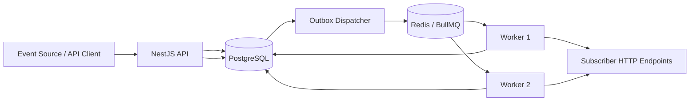
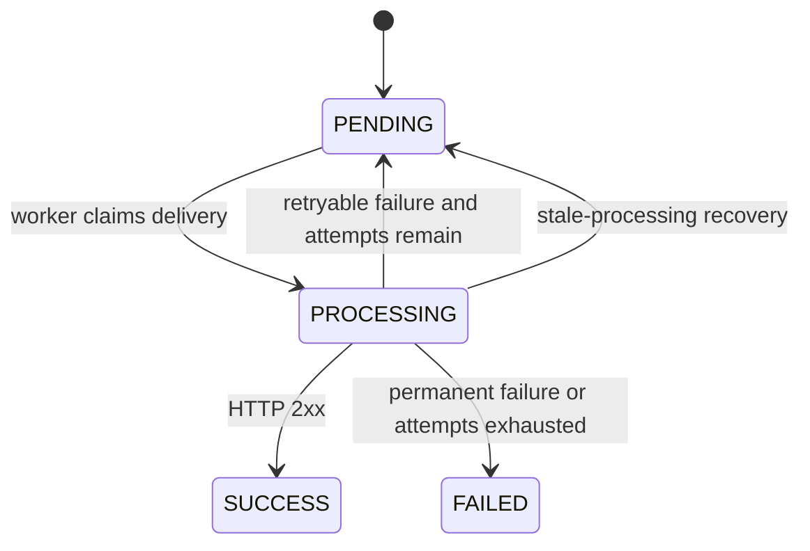

# Webhook Delivery Service — Architecture & Design

**Status:** Proposed design  
**Stack:** Node.js, TypeScript, NestJS, PostgreSQL, Prisma, Redis, BullMQ  
**Initial event type:** `PAYMENT_COMPLETED`  
**Workers:** Two concurrent workers  
**Scope:** Backend-only challenge implementation

---

## 1. Purpose

Build a reusable webhook delivery service that accepts payment events through an API, creates delivery work for matching subscriptions, sends HTTP POST requests to subscriber endpoints, retries failed requests according to a fixed schedule, and exposes delivery history and status through an API.

The design should be small enough to implement as a focused challenge while preserving reliable delivery behavior and a clear path to adding more event types.

### Goals

- Accept and persist incoming payment events.
- Allow clients to create, list, update, deactivate, and delete webhook subscriptions.
- Fan out each event to every active subscription matching its event type.
- Deliver webhooks asynchronously through BullMQ.
- Record a complete audit trail for each HTTP attempt.
- Retry retryable failures according to the specified schedule.
- Avoid duplicate logical deliveries when the same source event is submitted more than once.
- Use a simple transactional outbox to reliably bridge PostgreSQL and Redis/BullMQ.
- Support two concurrent workers without allowing both to claim the same logical delivery at the same time.
- Expose delivery status, details, and attempt history.

### Non-goals for the initial version

- Frontend or dashboard.
- Blockchain integration.
- Timestamped signatures and replay-window enforcement.
- Manual retry endpoint.
- Multiple event types beyond the first payment event.
- Exactly-once HTTP delivery (not achievable across an arbitrary network).
- Complex outbox leasing, distributed orchestration, or multi-region deployment.

---

## 2. High-level architecture



### Components

| Component | Responsibility |
|---|---|
| NestJS API | Validates requests and exposes event, subscription, and delivery APIs. |
| PostgreSQL | Source of truth for events, subscriptions, logical deliveries, attempt logs, and outbox records. |
| Prisma | Database access and transaction management. |
| Outbox dispatcher | Reads unpublished outbox rows and publishes corresponding jobs to BullMQ. |
| Redis / BullMQ | Stores and schedules asynchronous delivery jobs and retry delays. |
| Worker processes | Atomically claim logical deliveries, send HTTP requests, record attempts, and update delivery status. |
| Subscriber endpoint | External consumer URL that receives the webhook POST. |

PostgreSQL is authoritative. BullMQ is the execution and scheduling mechanism, not the permanent record of delivery state.

---

## 3. Core delivery semantics

### 3.1 At-least-once delivery

The system provides **at-least-once delivery attempts**, subject to the service and destination eventually recovering. It does not guarantee exactly-once side effects at the consumer.

For example, a consumer may process a request successfully, but the sender can time out before receiving the response. The sender may then retry the request. The consumer must deduplicate requests if duplicate side effects are unacceptable.

### 3.2 Idempotency identifiers

There are two separate idempotency boundaries:

1. **Incoming event:** `sourceEventId` uniquely identifies the event supplied by the upstream source. A repeated source event ID must not create another event or another set of deliveries.
2. **Outbound logical delivery:** the stable `Webhook.id` is sent as the `Idempotency-Key` HTTP header on every attempt for that logical delivery. All retries for the same event/subscription pair use the same key.

A separate HTTP attempt has its own `WebhookDelivery.id` and `attemptNumber`, but those values are not used as the outbound idempotency key.

### 3.3 Success and failure

- Any HTTP status from **200 through 299** is a successful delivery.
- Any non-2xx HTTP status is a failed attempt and is retried until the attempt limit is exhausted.
- Connection failures, DNS/network errors, and timeouts are failed attempts and are retryable.
- Local unrecoverable failures, such as an invalid or disallowed endpoint configuration, may be marked permanent rather than retried.
- After all six attempts have failed, the logical delivery becomes permanently `FAILED`.
- There is no manual retry endpoint in the initial version.

### 3.4 Attempt limit and retry schedule

There are **six total attempts**: one initial attempt plus five retries.

| Attempt | Timing |
|---:|---|
| 1 | Immediately |
| 2 | 1 minute after attempt 1 fails |
| 3 | 10 minutes after attempt 2 fails |
| 4 | 30 minutes after attempt 3 fails |
| 5 | 1 hour after attempt 4 fails |
| 6 | 24 hours after attempt 5 fails |

The delay is measured from completion of the preceding failed attempt. No retry is scheduled after attempt 6.

Use a BullMQ custom backoff strategy or an equivalent explicit scheduling strategy. The delay mapping and total-attempt count must be covered by tests. The database `attemptCount` and attempt records remain the audit source of truth; BullMQ's internal attempt counter must not be the only record.

---

## 4. Domain model and terminology

The following terms have distinct meanings:

- **WebhookEvent:** one incoming event received from the upstream event source.
- **WebhookSubscription:** a configured subscriber endpoint and the event type(s) it is interested in. The first version supports one event type per subscription.
- **Webhook:** one logical delivery of one event to one subscription. This record persists across retries.
- **WebhookDelivery:** one individual HTTP attempt to deliver a `Webhook`.
- **OutboxMessage:** a durable instruction to enqueue a logical delivery in BullMQ.

The name `WebhookDelivery` intentionally refers to an attempt, while `Webhook` refers to the overall logical delivery. This distinction should be maintained consistently in code and API responses.

---

## 5. Database design

Use PostgreSQL with Prisma. UUIDs are used for primary keys. Timestamps are stored as database timestamps and handled consistently in UTC.

### 5.1 Enums

```prisma
enum WebhookEventType {
  PAYMENT_COMPLETED
}

enum WebhookStatus {
  PENDING
  PROCESSING
  SUCCESS
  FAILED
}

enum WebhookAttemptStatus {
  PENDING
  SUCCESS
  FAILED
}

enum WebhookFailureReason {
  TIMEOUT
  NETWORK_ERROR
  HTTP_ERROR
  INVALID_RESPONSE
  INTERNAL_ERROR
}
```

`WebhookEventType` is used consistently for the subscription, event, and logical delivery records. Adding a new event type requires a Prisma/database enum migration and corresponding validation/handling. That is acceptable for this small initial implementation.

### 5.2 Prisma schema

This is the canonical schema reference. Keep each model defined only once. The `endpoint` field on `Webhook` pins the destination URL at the time the logical delivery is created, so retries remain directed to the same destination even if the subscription changes later.

```prisma
generator client {
  provider = "prisma-client-js"
}

datasource db {
  provider = "postgresql"
  url      = env("DATABASE_URL")
}

enum WebhookEventType {
  PAYMENT_COMPLETED
}

enum WebhookStatus {
  PENDING
  PROCESSING
  SUCCESS
  FAILED
}

enum WebhookAttemptStatus {
  PENDING
  SUCCESS
  FAILED
}

enum WebhookFailureReason {
  TIMEOUT
  NETWORK_ERROR
  HTTP_ERROR
  INVALID_RESPONSE
  INTERNAL_ERROR
}

model WebhookSubscription {
  id        String           @id @default(uuid()) @db.Uuid
  eventType WebhookEventType
  endpoint  String           @db.VarChar(2048)
  isActive  Boolean          @default(true)
  createdAt DateTime         @default(now())
  updatedAt DateTime         @updatedAt
  deletedAt DateTime?

  webhooks Webhook[]

  @@index([eventType, isActive, deletedAt])
  @@index([createdAt])
}

model WebhookEvent {
  id            String           @id @default(uuid()) @db.Uuid
  sourceEventId String           @unique @db.VarChar(255)
  eventType     WebhookEventType
  payload       Json
  occurredAt    DateTime?
  receivedAt    DateTime         @default(now())
  createdAt     DateTime         @default(now())

  webhooks Webhook[] @relation("WebhookEventDeliveries")

  @@index([eventType, receivedAt])
}

model Webhook {
  id                  String           @id @default(uuid()) @db.Uuid
  eventId             String           @db.Uuid
  subscriptionId      String           @db.Uuid
  eventType           WebhookEventType
  endpoint            String           @db.VarChar(2048)
  status              WebhookStatus    @default(PENDING)
  payload             Json
  attemptCount        Int              @default(0)
  failureReason       String?          @db.Text
  nextAttemptAt       DateTime?
  lastAttemptAt       DateTime?
  succeededAt         DateTime?
  processingStartedAt DateTime?
  createdAt           DateTime         @default(now())
  updatedAt           DateTime         @updatedAt

  event        WebhookEvent        @relation("WebhookEventDeliveries", fields: [eventId], references: [id], onDelete: Restrict)
  subscription WebhookSubscription @relation(fields: [subscriptionId], references: [id], onDelete: Restrict)
  attempts     WebhookDelivery[]
  outbox       OutboxMessage?

  @@unique([subscriptionId, eventId])
  @@index([status, nextAttemptAt])
  @@index([subscriptionId, createdAt])
  @@index([eventId])
}

model WebhookDelivery {
  id               String               @id @default(uuid()) @db.Uuid
  webhookId        String               @db.Uuid
  attemptNumber    Int
  endpointAudit    String               @db.VarChar(2048)
  status           WebhookAttemptStatus @default(PENDING)
  failureReason    WebhookFailureReason?
  failureDetails   String?              @db.Text
  clientHttpStatus Int?
  responseBody     String?              @db.Text
  durationMs       Int?
  startedAt        DateTime             @default(now())
  completedAt      DateTime?
  createdAt        DateTime             @default(now())
  updatedAt        DateTime             @updatedAt

  webhook Webhook @relation(fields: [webhookId], references: [id], onDelete: Restrict)

  @@unique([webhookId, attemptNumber])
  @@index([webhookId, createdAt])
  @@index([status, startedAt])
}

model OutboxMessage {
  id          String    @id @default(uuid()) @db.Uuid
  webhookId   String    @unique @db.Uuid
  type        String    @db.VarChar(100)
  payload     Json
  publishedAt DateTime?
  createdAt   DateTime  @default(now())
  updatedAt   DateTime  @updatedAt

  webhook Webhook @relation(fields: [webhookId], references: [id], onDelete: Restrict)

  @@index([publishedAt, createdAt])
}
```

### 5.3 Model responsibilities and invariants

#### `WebhookSubscription`

- `eventType`: enum identifying the event this subscription accepts.
- `endpoint`: destination URL.
- `isActive`: whether new events may create deliveries for this subscription.
- `deletedAt`: soft-delete timestamp. A deleted subscription is not selected for new events.
- Existing `Webhook` records are retained for audit/history.

#### `WebhookEvent`

- `sourceEventId` is unique and enforces incoming-event idempotency.
- `payload` stores the event payload as received after validation.
- `receivedAt` records when the service accepted the event.

#### `Webhook`

- Represents one event-to-subscription delivery.
- `@@unique([subscriptionId, eventId])` is a second protection against duplicate logical deliveries.
- `attemptCount` counts HTTP attempts started for this logical delivery.
- `nextAttemptAt` records the next scheduled retry time when applicable.
- `processingStartedAt` supports recovery of jobs stuck in `PROCESSING`.
- `payload` is a snapshot of the payload to deliver. This prevents later source-data changes from changing an already-created delivery.

#### `WebhookDelivery`

- One row per HTTP attempt.
- `endpointAudit` snapshots the destination URL used for that attempt, even if the subscription is later changed or deleted.
- `clientHttpStatus` stores the received HTTP status when a response exists.
- `responseBody` and `failureDetails` must be bounded in size to avoid storing arbitrarily large data.
- `durationMs`, `startedAt`, and `completedAt` provide observability.
- `@@unique([webhookId, attemptNumber])` prevents duplicate attempt numbers for one logical delivery.

#### `OutboxMessage`

- One row per logical delivery that must be published to BullMQ.
- `webhookId` is unique so a logical delivery has one initial outbox record.
- `payload` should be small, for example `{ "webhookId": "<uuid>" }`.
- `publishedAt = null` means the dispatcher has not recorded a successful enqueue.
- This is a simple outbox: no separate outbox status machine is required initially.

---

## 6. Transactional outbox

### 6.1 Why it is needed

PostgreSQL and Redis do not share a transaction. Without an outbox, the API can commit the event and logical delivery rows, then crash before adding the job to BullMQ. The database would show pending work that never runs.

The outbox makes the intent to enqueue part of the same PostgreSQL transaction as event ingestion and fan-out. A separate dispatcher eventually publishes that intent to BullMQ.

### 6.2 Event-ingestion transaction

For `POST /api/v1/payment-events`, perform the following in one Prisma transaction:

1. Validate the event DTO and event type.
2. Insert `WebhookEvent` using `sourceEventId`.
3. Find subscriptions where:
   - `eventType` matches the incoming event,
   - `isActive = true`,
   - `deletedAt IS NULL`.
4. For each matching subscription:
   - Create one `Webhook` with the event payload snapshot and status `PENDING`.
   - Create one `OutboxMessage` with the new `Webhook.id` and a small job payload.
5. Commit the transaction.
6. Return `202 Accepted`.

If `sourceEventId` already exists, return an idempotent response and do not fan out the event again. The API should define a clear response contract for duplicates (for example, `200 OK` with the existing event ID, or `202 Accepted` with the same logical result).

If any operation in the transaction fails, the event, logical deliveries, and outbox messages all roll back together.

### 6.3 Dispatcher flow

A small scheduled/polling dispatcher runs continuously or on a short interval:

1. Query a bounded batch of unpublished outbox rows ordered by `createdAt`.
2. For each row, enqueue a BullMQ job with a deterministic job ID derived from the logical delivery ID, such as `webhook-<webhookId>`.
3. After BullMQ confirms enqueueing, set `publishedAt`.
4. If enqueueing fails, leave `publishedAt` null so the next poll can retry.

Use bounded batches and avoid loading the whole outbox table into memory. For a small challenge, one dispatcher process is sufficient. If multiple dispatchers are later used, claim rows atomically (for example with `FOR UPDATE SKIP LOCKED`) or use a short lease so they do not continually race over the same rows.

### 6.4 Duplicate enqueue safety

A crash can happen after BullMQ accepts a job but before PostgreSQL records `publishedAt`. The dispatcher will try to enqueue it again.

This is expected and must be safe:

- Use a deterministic BullMQ job ID.
- The worker must atomically claim the `Webhook` record before sending HTTP.
- Only the worker that successfully claims the logical delivery may proceed.
- If the logical delivery is already `SUCCESS`, `FAILED`, or actively `PROCESSING`, a duplicate job should exit without making another HTTP request.

BullMQ job IDs reduce duplicate queue entries, but the database claim is the authoritative guard.

### 6.5 Simple outbox boundaries

For the initial challenge, do not build a complex event bus or a general-purpose outbox framework. The outbox only needs to represent: “this logical delivery must be enqueued.” A periodic polling loop provides recovery if the immediate dispatch path is unavailable.

---

## 7. Delivery lifecycle and state transitions



### State meanings

| State | Meaning |
|---|---|
| `PENDING` | Waiting for the first attempt or a scheduled retry. |
| `PROCESSING` | A worker has atomically claimed the logical delivery. |
| `SUCCESS` | A 2xx response was received and recorded. Terminal. |
| `FAILED` | A permanent failure occurred or all six attempts failed. Terminal in the initial version. |

### Atomic claim

Before performing an HTTP request, a worker must atomically change a delivery from `PENDING` to `PROCESSING` only if it is eligible to run.

Conceptually:

```sql
UPDATE "Webhook"
SET
  status = 'PROCESSING',
  "processingStartedAt" = NOW(),
  "updatedAt" = NOW()
WHERE id = $1
  AND status = 'PENDING'
  AND ("nextAttemptAt" IS NULL OR "nextAttemptAt" <= NOW())
RETURNING id;
```

If no row is returned, the worker must not send an HTTP request. This protects against two workers or duplicate jobs processing the same delivery simultaneously.

Before sending, create the next `WebhookDelivery` attempt record and increment `attemptCount` in a transaction. Use the resulting attempt number and unique constraint to maintain a consistent audit history.

**Concurrency note:** A worker process can crash at several points. The implementation must ensure a stale `PROCESSING` delivery can be recovered without allowing a second worker to race with an active request. Use a conservative processing timeout/lease based on the HTTP timeout plus margin. A production-hardened design can add a lease token or fencing mechanism; for this small challenge, document the recovery rule and test it.

---

## 8. Worker and HTTP delivery flow

For each BullMQ job:

1. Read `webhookId` from the job.
2. Load the logical delivery and verify that it is eligible.
3. Atomically claim it (`PENDING` → `PROCESSING`). If claim fails, exit without an HTTP request.
4. Create a `WebhookDelivery` attempt row and increment `attemptCount` atomically.
5. Resolve the endpoint snapshot for this attempt. Do not require the subscription to remain active; deactivation or deletion must not cancel deliveries that were already created.
6. Send an HTTP `POST` with:
   - `Content-Type: application/json`
   - `Idempotency-Key: <Webhook.id>`
   - A documented event envelope containing the event ID, type, timestamp, and payload.
7. Enforce a finite HTTP timeout and response-body size limit.
8. Record the status code (if a response exists), bounded response body, duration, completion time, and success/failure classification.
9. If the response is 2xx:
   - Mark the attempt `SUCCESS`.
   - Mark the logical `Webhook` `SUCCESS`.
   - Set `succeededAt`.
   - Clear `nextAttemptAt` and `processingStartedAt`.
10. If the attempt fails:
    - Mark the attempt `FAILED` with a reason and safe diagnostic details.
    - If retryable and fewer than six attempts have started, set the logical delivery back to `PENDING`, set `nextAttemptAt`, and schedule the next retry.
    - Otherwise, mark the logical delivery `FAILED` and clear processing/retry timestamps.
11. Emit structured logs with correlation IDs, without logging secrets or unrestricted payloads.

The worker must not make an HTTP request if it cannot persist/claim the attempt. Otherwise, it could make an untracked attempt.

### HTTP request envelope

Use a stable, versionable envelope. For example:

```json
{
  "id": "source-event-id",
  "type": "PAYMENT_COMPLETED",
  "occurredAt": "2026-10-15T00:00:00.000Z",
  "data": {
    "paymentId": "pay_123",
    "amount": 5000,
    "currency": "USD"
  }
}
```

The exact payment payload contract should be documented and validated at the API boundary. The event's source ID is distinct from the logical outbound `Webhook.id`; the `Idempotency-Key` header carries the latter.

### Endpoint snapshot

To ensure retries are auditable if a subscription endpoint is updated, decide explicitly whether each logical delivery pins its endpoint at creation time. For this design, **the endpoint is pinned to the logical delivery when it is created**. Add an `endpoint` snapshot field to `Webhook`, or otherwise persist the chosen endpoint before dispatch. `WebhookDelivery.endpointAudit` then records the actual URL used on each attempt.

This is important: without a logical-delivery endpoint snapshot, a retry could unexpectedly be sent to a new URL after a subscription update. The schema should therefore include:

```prisma
// Add to model Webhook:
endpoint String @db.VarChar(2048)
```

Populate it from the subscription during event fan-out. Each attempt copies `Webhook.endpoint` to `WebhookDelivery.endpointAudit`.

---

## 9. Retry scheduling with BullMQ

### Recommended implementation

Use one logical BullMQ job per `Webhook` and configure six total attempts with the required custom backoff delays. Ensure that:

- A retryable HTTP failure is surfaced to BullMQ as a retryable job failure after the database is updated.
- A permanent failure is marked in the database and is not retried by BullMQ.
- The worker's database state transition and BullMQ retry behavior remain consistent.
- Reconciliation can re-enqueue a pending logical delivery if queue state and database state diverge.

BullMQ's retry mechanism and the database status are two systems, so do not assume they are updated atomically. If you instead choose to schedule each retry through a new outbox row, make that decision explicit and test it. For the challenge, a BullMQ custom backoff is sufficient as long as reconciliation is implemented.

### Retry delay mapping

```ts
const RETRY_DELAYS_MS = [
  60_000,        // retry after attempt 1 fails: 1 minute
  10 * 60_000,   // retry after attempt 2 fails: 10 minutes
  30 * 60_000,   // retry after attempt 3 fails: 30 minutes
  60 * 60_000,   // retry after attempt 4 fails: 1 hour
  24 * 60 * 60_000, // retry after attempt 5 fails: 24 hours
];
```

The exact BullMQ custom backoff index semantics should be verified against the installed BullMQ version. Write a unit test that asserts the returned delay for each retry index rather than relying on assumptions about zero-based indexing.

### Avoid double scheduling

Choose one source to schedule a given retry. Do not both throw a retryable error to BullMQ and independently enqueue a second retry job from application code for the same attempt. The reconciliation process should repair missing work, not create an independent parallel retry policy.

---

## 10. Subscription behavior

### Create

`POST /api/v1/webhook-subscriptions` creates an active subscription with an event type and endpoint.

Validate the endpoint before saving it. Only supported event types may be registered.

### Update

`PATCH /api/v1/webhook-subscriptions/:id` can update allowed fields, such as endpoint or active status. For already-created logical deliveries, the endpoint snapshot does not change.

### Deactivate

Setting `isActive = false` prevents future incoming events from creating new deliveries for the subscription. It does not cancel already-created deliveries.

### Delete

`DELETE /api/v1/webhook-subscriptions/:id` performs a soft delete by setting `deletedAt` and `isActive = false`. Historical deliveries remain available. Do not hard-delete subscriptions while they are referenced by delivery history.

### Fan-out rule

At the time the event-ingestion transaction runs, select only subscriptions where the event type matches, `isActive = true`, and `deletedAt IS NULL`. This defines which subscriptions receive that event. Subscriptions created after the event was accepted do not receive historical events automatically.

---

## 11. API design

Prefix all routes with `/api/v1`.

### 11.1 Ingest payment event

`POST /api/v1/payment-events`

Example request:

```json
{
  "eventId": "payment-event-123",
  "type": "PAYMENT_COMPLETED",
  "occurredAt": "2026-10-15T00:00:00.000Z",
  "payload": {
    "paymentId": "pay_123",
    "amount": 5000,
    "currency": "USD"
  }
}
```

Behavior:

- Validate request structure and event type.
- Enforce uniqueness of `eventId` (mapped to `sourceEventId`).
- Create the event, logical deliveries, and outbox messages in one transaction.
- Return `202 Accepted` after the transaction commits.

Example response:

```json
{
  "eventId": "payment-event-123",
  "accepted": true,
  "deliveriesCreated": 3
}
```

A duplicate event must not create new deliveries. Document and test the chosen duplicate response behavior.

### 11.2 Subscription endpoints

| Method | Route | Purpose |
|---|---|---|
| `POST` | `/api/v1/webhook-subscriptions` | Create a subscription. |
| `GET` | `/api/v1/webhook-subscriptions` | List subscriptions with pagination and optional filters. |
| `GET` | `/api/v1/webhook-subscriptions/:id` | Get one subscription. |
| `PATCH` | `/api/v1/webhook-subscriptions/:id` | Update endpoint or active status. |
| `DELETE` | `/api/v1/webhook-subscriptions/:id` | Soft-delete/deactivate a subscription. |

Example create request:

```json
{
  "eventType": "PAYMENT_COMPLETED",
  "endpoint": "https://consumer.example.com/webhooks/payments"
}
```

### 11.3 Delivery query endpoints

| Method | Route | Purpose |
|---|---|---|
| `GET` | `/api/v1/webhooks` | List logical deliveries with pagination and filters. |
| `GET` | `/api/v1/webhooks/:id` | Get logical delivery status and details. |
| `GET` | `/api/v1/webhooks/:id/deliveries` | List individual HTTP attempts for a logical delivery. |

Useful filters for `GET /api/v1/webhooks` include `status`, `eventType`, `subscriptionId`, `eventId`, `createdAfter`, and `createdBefore`. Use pagination (cursor-based or limit/offset) and stable sorting by creation time and ID.

Example logical delivery response:

```json
{
  "id": "logical-delivery-uuid",
  "eventId": "event-uuid",
  "subscriptionId": "subscription-uuid",
  "eventType": "PAYMENT_COMPLETED",
  "status": "PENDING",
  "attemptCount": 2,
  "nextAttemptAt": "2026-10-15T00:10:00.000Z",
  "lastAttemptAt": "2026-10-15T00:00:00.000Z",
  "succeededAt": null,
  "attempts": [
    {
      "id": "attempt-uuid",
      "attemptNumber": 1,
      "status": "FAILED",
      "clientHttpStatus": 503,
      "failureReason": "HTTP_ERROR",
      "durationMs": 250
    }
  ]
}
```

Do not return unbounded response bodies by default. Consider a separate detail option or truncated body field.

---

## 12. NestJS module structure

Keep the code organized by the webhook domain while separating API, persistence, queue, and HTTP concerns.

```text
src/
├── app.module.ts
├── main.ts
├── prisma/
│   ├── prisma.module.ts
│   └── prisma.service.ts
└── webhook/
    ├── webhook.module.ts
    ├── webhook.types.ts
    ├── webhook.constants.ts
    ├── webhook.events.ts
    ├── controllers/
    │   ├── payment-events.controller.ts
    │   ├── webhook-subscriptions.controller.ts
    │   └── webhooks.controller.ts
    ├── dto/
    │   ├── receive-payment-event.dto.ts
    │   ├── create-subscription.dto.ts
    │   ├── update-subscription.dto.ts
    │   └── list-webhooks-query.dto.ts
    ├── services/
    │   ├── webhook-event.service.ts
    │   ├── webhook-subscription.service.ts
    │   ├── webhook-dispatch.service.ts
    │   ├── webhook-attempt.service.ts
    │   └── webhook-reconciliation.service.ts
    ├── outbox/
    │   ├── outbox.service.ts
    │   └── outbox-dispatcher.service.ts
    ├── queue/
    │   ├── webhook-queue.module.ts
    │   ├── webhook-queue.service.ts
    │   ├── worker/
    │   │   ├── webhook.processor.ts
    │   │   ├── webhook-worker-thread.ts
    │   │   ├── webhook-worker-threads.service.ts
    │   │   └── webhook-worker.module.ts
    │   └── webhook-retry.policy.ts
    └── http/
        └── webhook-http-client.service.ts
```

### Responsibility guidelines

- Controllers handle HTTP transport, DTOs, and response codes.
- Services own domain use cases and transactions.
- The outbox dispatcher publishes durable work to BullMQ.
- The queue processor orchestrates a single delivery attempt and state transitions.
- The HTTP client handles timeouts, response limits, and HTTP behavior.
- The retry policy contains the delay mapping and retry classification.
- Reconciliation repairs known gaps between database state and queue execution.
- Avoid putting business logic directly in controllers or queue processors.

---

## 13. Security and operational safeguards

Consumer-side signature verification support is provided by the per-subscription HMAC secret and request signature. Timestamped signatures and replay-window enforcement remain out of scope for this version; the service still needs the following basic safeguards.

### 13.1 Protect API operations

- Protect event-ingestion and subscription-management APIs with authentication appropriate to the challenge environment.
- Do not expose subscription-management endpoints publicly without access control.
- Validate request sizes and DTO fields.
- Apply reasonable rate limits if the API is exposed beyond a trusted test environment.

### 13.2 Prevent SSRF

Because the service makes HTTP requests to user-configured endpoints, endpoint validation is essential:

- Allow only `https` in production; permit `http` only in a controlled local test setup if needed.
- Reject loopback, private, link-local, multicast, and reserved IP ranges, including IPv4-mapped IPv6 cases.
- Resolve DNS and validate resolved IP addresses, and account for DNS rebinding.
- Disable redirects or revalidate every redirect target before following it.
- Block cloud metadata endpoints.
- Apply outbound network-level restrictions where possible.

URL validation alone is not sufficient against SSRF.

### 13.3 HTTP resource limits

- Use a finite request timeout.
- Limit response-body bytes read and stored.
- Do not follow redirects by default.
- Avoid unlimited concurrency; configure queue worker concurrency deliberately.
- Ensure each worker makes a bounded number of requests at a time.

### 13.4 Logging and secrets

- Never log authentication tokens, shared secrets, or sensitive request headers.
- Do not log full event payloads by default.
- Truncate stored response bodies and error details.
- Sanitize endpoint URLs if they may contain credentials or sensitive query parameters.

### 13.5 Consumer authentication

The implementation adds an HMAC-SHA256 signature using a random secret per subscription. The secret is returned on creation and explicit rotation, and is omitted from ordinary subscription reads. Each outbound request includes `X-Webhook-Signature: sha256=<hex>`, computed over the exact UTF-8 JSON body. Timestamp headers and a replay window remain future work; consumers should also use the stable `Idempotency-Key` to deduplicate retries.

---

## 14. Reliability and reconciliation

### 14.1 Unpublished outbox rows

Periodically retry outbox rows where `publishedAt IS NULL`. Do not mark an outbox row published until BullMQ confirms the job was accepted.

### 14.2 Stale `PROCESSING` deliveries

A worker may die after claiming a delivery. A reconciliation job should find deliveries that have remained in `PROCESSING` longer than the configured processing threshold.

Before returning a stale delivery to `PENDING`, ensure the threshold exceeds the HTTP timeout plus a safety margin and ensure the original worker cannot still be actively processing the same request. For a stronger implementation, use a lease token/fencing value to prevent an old worker from overwriting a newer attempt's state.

### 14.3 Pending deliveries without queue work

Periodically inspect eligible `PENDING` deliveries that have no effective queue job and re-enqueue them safely. Use deterministic job IDs and database claims so repeated reconciliation does not create concurrent HTTP sends.

### 14.4 Consistency rule

Database state transitions should be conditional. A worker must not overwrite a terminal `SUCCESS` or `FAILED` state. Update the attempt record and logical delivery in transactions where practical.

---

## 15. Configuration

Use environment variables and validate them at application startup.

| Variable | Purpose |
|---|---|
| `DATABASE_URL` | PostgreSQL connection string. |
| `REDIS_HOST` | Redis hostname. |
| `REDIS_PORT` | Redis port. |
| `REDIS_PASSWORD` | Optional Redis password. |
| `WEBHOOK_HTTP_TIMEOUT_MS` | Maximum time for one outbound HTTP attempt. |
| `WEBHOOK_MAX_RESPONSE_BYTES` | Maximum response body bytes to read/store. |
| `WEBHOOK_WORKER_COUNT` | Number of additional Node.js worker threads that host BullMQ consumers; defaults to `1`. The main NestJS thread also consumes jobs. |
| `WEBHOOK_WORKER_CONCURRENCY` | Number of jobs each thread's BullMQ consumer may execute concurrently. |
| `OUTBOX_POLL_INTERVAL_MS` | Outbox dispatcher polling interval. |
| `RECONCILIATION_INTERVAL_MS` | Frequency of recovery checks. |
| `NODE_ENV` | Runtime environment. |

The main NestJS thread consumes the queue, and one additional Node.js worker thread is started by default. BullMQ concurrency is `2` in each consumer. Set `WEBHOOK_WORKER_COUNT` to increase the number of additional NestJS consumer threads; total in-flight capacity per service instance is `(WEBHOOK_WORKER_COUNT + 1) × WEBHOOK_WORKER_CONCURRENCY`. Each consumer thread reads from the same Redis queue and uses the same PostgreSQL database.

---

## 16. Testing strategy

Use unit tests for policy and service logic, and integration tests with PostgreSQL/Redis or test containers for concurrency and queue behavior. A small local HTTP test server can simulate subscriber endpoints.

### Required tests

#### Event ingestion and idempotency

- A valid payment event is stored and returns `202`.
- A duplicate `sourceEventId` does not create another event or duplicate deliveries.
- A matching active subscription creates exactly one logical delivery and outbox row.
- Inactive or soft-deleted subscriptions do not receive new events.
- A subscription created after event acceptance does not receive the old event.
- A failure inside the transaction leaves no partial event/delivery/outbox state.

#### Worker and concurrency

- A 2xx response marks the attempt and logical delivery successful.
- A non-2xx response is recorded and retried.
- Timeout and network errors are recorded and retried.
- Two workers processing the same job cannot both claim and send the same logical delivery concurrently.
- A duplicate BullMQ job for a terminal delivery performs no HTTP request.
- Endpoint snapshots remain stable after a subscription endpoint update.
- A worker does not send an HTTP request if the database claim/attempt creation fails.

#### Retry policy

- The exact five retry delays are returned for the expected retry indices.
- Six total attempts are allowed, with no seventh attempt.
- After the sixth failed attempt, the logical delivery becomes `FAILED`.
- Permanent failures do not retry.
- The attempt log has one row per started attempt and unique sequential attempt numbers.

#### Outbox and recovery

- An unpublished outbox row is eventually published.
- A dispatcher retry after enqueue success but before marking `publishedAt` is safe.
- A queue failure leaves the outbox row eligible for a later retry.
- Stale `PROCESSING` deliveries are recovered according to the lease/timeout rule.
- Reconciliation does not create concurrent duplicate HTTP sends.

#### Subscription behavior and API

- Deactivation and deletion prevent new deliveries but do not cancel existing deliveries.
- Pagination and status filters return stable results.
- Attempt history includes endpoint snapshot, HTTP status when present, duration, timestamps, and failure details.
- SSRF endpoint validation rejects local/private targets and unsafe redirects.

---

## 17. Observability

At minimum, provide structured logs for:

- Event accepted (source event ID and event type).
- Number of logical deliveries created.
- Outbox job published (outbox ID and webhook ID).
- Attempt started and completed.
- Attempt outcome, HTTP status, duration, and retry delay.
- Delivery terminal state.
- Reconciliation action and reason.

Useful metrics include:

- Number of `PENDING`, `PROCESSING`, `SUCCESS`, and `FAILED` logical deliveries.
- Outbox backlog size and age of oldest unpublished row.
- Attempt success rate and failure rate by status/reason.
- Retry count distribution.
- Delivery latency from event acceptance to success.
- Number and age of stale `PROCESSING` deliveries.

Do not make metrics or logs a substitute for persisted attempt history.

---

## 18. Implementation plan

A reasonable focused implementation plan is:

1. **Project setup and schema**
   - Create NestJS project, Prisma schema, PostgreSQL/Redis development setup.
   - Add migrations and startup configuration validation.
2. **Subscriptions and event ingestion**
   - Implement DTO validation and subscription CRUD.
   - Implement event idempotency and transactional fan-out/outbox creation.
3. **Outbox dispatcher and BullMQ**
   - Implement polling, deterministic job IDs, and published timestamp updates.
4. **Delivery worker**
   - Implement atomic claim, attempt creation, HTTP client, and status persistence.
5. **Retries and reconciliation**
   - Add retry policy, permanent failure handling, stale-processing recovery, and queue/database reconciliation.
6. **History APIs**
   - Implement logical delivery listing/detail and attempt history.
7. **Tests and documentation**
   - Cover idempotency, concurrency, retries, outbox recovery, subscription lifecycle, and endpoint safety.
   - Add Docker Compose and example requests.

A practical target is roughly **12–17 hours**, depending on test infrastructure and how much recovery logic is implemented. If time is limited, prioritize transactional ingestion, atomic worker claims, complete attempt history, retries, and SSRF protection before optional metrics.

---

## 19. Design decisions summary

| Decision | Choice |
|---|---|
| Framework | NestJS + TypeScript |
| ORM | Prisma |
| Database | PostgreSQL |
| Queue | BullMQ + Redis |
| Initial event type | `PAYMENT_COMPLETED` enum |
| Event ingestion | API |
| Incoming idempotency | Unique `sourceEventId` |
| Logical delivery identity | One `Webhook` per `(subscriptionId, eventId)` |
| Attempt audit model | `WebhookDelivery` |
| Outbox | Simple transactional outbox table and polling dispatcher |
| Worker concurrency | Configurable consumer threads sharing one queue |
| Claim protection | Atomic conditional PostgreSQL update |
| Outbound idempotency header | `Idempotency-Key: <Webhook.id>` |
| Success | Any 2xx response |
| Retryable failures | Non-2xx responses, network failures, timeouts |
| Retry policy | 1 minute, 10 minutes, 30 minutes, 1 hour, 24 hours |
| Total attempts | Six including the initial attempt |
| Terminal failure | `FAILED` after attempts are exhausted or a permanent failure |
| Subscription deactivation | Prevents new deliveries; existing deliveries continue |
| Subscription deletion | Soft delete |
| Manual retry | Out of scope |
| Request signature | HMAC-SHA256 per subscription over exact JSON body |
| Delivery guarantee | At-least-once attempts; consumer idempotency needed for duplicate side-effect prevention |

---

## 20. Final implementation notes

Before writing the implementation, settle these details in code and tests:

1. Keep one canonical `WebhookEvent` model in `schema.prisma`; use the paired relation definitions from Section 5.4.
2. Add the `endpoint` snapshot field to `Webhook`, as specified in Section 8.
3. Verify the installed BullMQ version's custom-backoff indexing and test the exact retry schedule.
4. Make duplicate source-event behavior deterministic and documented.
5. Use database state and conditional updates as the authority for delivery claims and terminal states.
6. Keep request/response size limits and SSRF defenses in place. Add timestamped signatures and replay-window enforcement in a future iteration.
7. Treat logs and responses as potentially sensitive; truncate response bodies and avoid logging secrets.
